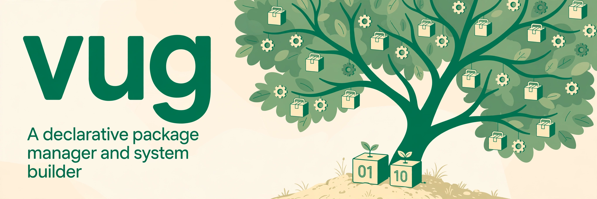

<p align="center">
  
</p>

<p align="center"><strong>A package manager and system builder with declarative TOML package records, a content-addressed store, and sandboxed builds</strong></p>

<p align="center">
  <a href="https://github.com/conao3/rust-vug/releases/latest"></a>
  <a href="https://github.com/conao3/rust-vug/actions/workflows/ci.yml"></a>
  <a href="LICENSE"></a>
  <a href="Cargo.toml"></a>
  <a href="lean-toolchain"></a>
  <a href="https://github.com/conao3/rust-vug/stargazers"></a>
</p>

<p align="center">
  <a href="#documentation">Documentation</a> |
  <a href="#records">Records</a> |
  <a href="#packages">Packages</a> |
  <a href="#systems">Systems</a> |
  <a href="#binary-caches">Binary caches</a> |
  <a href="#check">Check</a> |
  <a href="https://github.com/conao3/rust-vug/releases">Releases</a> |
  <a href="https://github.com/conao3/vug-packages">vug-packages</a>
</p>

# vug

`vug` is a declarative package manager and system builder.

- Packages, services and systems are TOML records that carry data only.
- Builds run in a sandbox that starts from 2 upstream binaries: busybox and
  zig.
- Outputs go to a content-addressed store.

The records live in [vug-packages](https://github.com/conao3/vug-packages). A
system built from them boots in QEMU, from a kernel given to QEMU or through
EFI firmware (OVMF). It switches between generations and builds its next
generation on the machine. It hasn't been started on real hardware yet.

```console
$ vug version compare-versions --left 1.2.10 --right 1.2.9
{
  "Ordering": "Greater"
}
```

## Documentation

| Document | Contents |
|---|---|
| [docs/record.md](docs/record.md) | Package records, the build kinds, the canonical form |
| [docs/build.md](docs/build.md) | Store paths, the seed, the compiler wrappers, the C++ runtime, how a build finds its dependencies |
| [docs/system.md](docs/system.md) | System and service records, the layout of a machine, switching and rolling back |
| [docs/home.md](docs/home.md) | User environment records, reusable fragments, and composition |
| [docs/merge-checks.md](docs/merge-checks.md) | Merge scope, check results, and merge decisions |
| [docs/cache.md](docs/cache.md) | Binary caches, signatures, garbage collection |

## Records

Package records live under `packages/<shard>/<name>/`: a `package.toml`, 1
file per version in `versions/`, and patches in `patches/`. 3 commands check
them (`--file` and `--root` are file system paths):

```console
$ vug record format-record --file packages/he/hello/versions/2.12.2.toml
{
  "Changed": false,
  "Record": "version = \"2.12.2\"\n..."
}
$ vug record check-record --file packages/he/hello/package.toml
$ vug record check-tree --root .
{
  "Errors": [],
  "Packages": 3,
  "Systems": 0,
  "Versions": 4
}
```

- `format-record` prints the canonical byte form of a record. `--write`
  rewrites the file.
- `check-record` exits 0 only for a valid, canonical file.
- `check-tree` validates every record under `DIR/packages` and every system
  under `DIR/systems`, counts them, and reports `Errors`.

## Packages

```console
$ vug package build-package --root . --name hello --jobs 4
{
  "Built": true,
  "HostPath": "/home/user/.local/share/vug/store/fcyko5ygdr5mwm2q5nrfkfgwhn2aphu2",
  "Name": "hello",
  "Path": "/vug/store/fcyko5ygdr5mwm2q5nrfkfgwhn2aphu2",
  "Version": "2.12.2"
}
```

`build-package` builds a package with the seed tools and its declared
dependencies, then moves its output to the content-addressed store. The build
sandbox uses a fixed user, group, hostname, locale, and source date epoch.
The flake package adds bubblewrap to `PATH`. A build made with Cargo needs
`bwrap` on `PATH`. The release archive holds a static `vug` and `vug-bwrap`,
the same bubblewrap built statically, and that `vug` runs its sandboxes with
the `vug-bwrap` next to it. See [the build documentation](docs/build.md).

```console
$ vug package run-package --root . --name slang --program bin/slsh --arguments --version
slsh version 0.9.4-0; S-Lang version: 2.3.3
```

`run-package` runs a program of a package with the store visible at
`/vug/store`, which dynamically linked programs need.

## Systems

```console
$ vug system build-system --root . --name minimal
$ vug system build-image --root . --name minimal --image minimal.img
```

`build-system` builds a system record ([docs/system.md](docs/system.md)) into
1 store path: packages, files below `/etc`, users, and the scripts that start
it and switch a running machine to it. `build-image` also writes a disk image:

- an ext4 file system for a kernel that QEMU loads directly, or
- a GPT disk with an EFI system partition when the record names a boot
  loader.

```console
# vug system switch-system --root /vug/tree --name systemd
# vug system delete-generations --keep 2
```

`switch-system` builds a system on the machine it runs on and makes it the
running generation. `delete-generations` drops old ones.

## Binary caches

```console
$ vug store generate-key --output text > cache.key
$ vug store export-cache --directory cache --secret-key-file cache.key
# vug store collect-garbage
```

`export-cache` writes a binary cache: a directory to serve over HTTP, with a
signature per entry. Give a build `--binary-cache URL --trusted-key KEY` (or
the same 2 values in `/etc/vug.toml`) and it takes outputs from the cache in
place of building them. It refuses entries the key didn't sign.
`collect-garbage` removes the store paths no generation reaches
([docs/cache.md](docs/cache.md)).

## Check

```console
$ nix develop --command make check
```

This runs the format check, clippy, the Lean proof build, the leanassay audit,
the generated-file consistency check, and the tests. `nix build` produces
`./result/bin/vug`.

## Release

```console
$ gh workflow run release.yml --ref master -f version_bump=patch
```

The release workflow raises the version in `Cargo.toml`, `Cargo.lock`, and
`flake.nix`, pushes that commit and the tag `v<version>`, and attaches
`vug-<version>-x86_64-linux-musl.tar.gz` (`nix build .#release`) to the
GitHub Release. The archive holds `vug` and `vug-bwrap`; unpack both into the
same directory.
